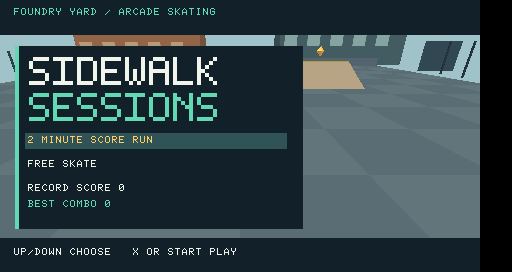

# Sidewalk Sessions

An original arcade skateboarding game for PSP. Chase a personal record in a
two-minute score run, explore in Free Skate, and complete five challenges in
**Foundry Yard**, our first industrial skate park. Sidewalk Sessions is a working
title; this is the first playable version.

[Download the PSP game](https://github.com/CaptainHookJL/Tony-Hawk-Pro-Skater-PSP/raw/refs/heads/main/downloads/SidewalkSessions-PSP.zip).
Open `EBOOT.PBP` in PPSSPP, or copy the `PSP/GAME/SidewalkSessions` folder to a PSP
configured to run homebrew.




## Play

Choose **2 Minute Score Run** or **Free Skate** with Up/Down, then Cross or Start.
Hold Cross to build speed and charge a pop, release to ollie, add tricks, and
land cleanly to bank the combo. Bails lose unbanked points.

Foundry Yard has two banks, a central grind rail, a solid loading platform, and
five floating gold spot markers. Skate into a marker to collect it. Start opens
the challenge card and pauses the clock. Complete all five challenges and score
5,000 points in a timed run to earn Gold.

| Challenge | Target |
| --- | --- |
| Session score | 2,500 banked points |
| Best combo | 1,000 points in one landed combo |
| Kickflips | Land three completed flips |
| Grinding | Land a cumulative second of grinding |
| Spot markers | Collect all five |

Bronze requires 1,000 points. Silver requires 2,500 points and three challenges.
At time up, an airborne or grinding combo has up to three seconds to land.
An unfinished combo is discarded at the end of that window.

Free Skate has no clock. End it from the pause card. The timed score record is
reserved for Score Runs; both modes can improve your all-time combo record.
Records are saved when a session ends in `sidewalk-records.dat` beside the game.
A `.bak` file retains the previous save for recovery.

## Controls

| PSP control | While skating |
| --- | --- |
| Analog stick left/right, or D-pad left/right | Steer on the ground |
| Hold Cross (X) | Push and charge an ollie |
| Release Cross (X) | Ollie |
| D-pad down | Brake |
| Square | Kickflip while airborne |
| Hold Circle | Indy grab while airborne |
| Hold Triangle | Catch and remain on the central rail while descending |
| L / R | Spin left / right while airborne |
| Start | Pause/resume and view challenges |
| Select | Respawn, keeping banked points and challenge progress |
| Home | Exit |

On the pause card, Triangle ends the session. On results, Cross retries;
Circle or Start returns to the title screen. Finish flips and align spins to a
multiple of 180 degrees before landing. From spawn, release Cross several board
lengths before the rail, then hold Triangle as you descend onto it.

## Build

Use the existing checkout; each cloud task is already isolated and needs no Git
worktree. The installer pins PSPDEV `v20261001` for Linux x86_64 and verifies the
official archive's SHA-256.

```bash
cd /workspace/Tony-Hawk-Pro-Skater-PSP
bash scripts/install-pspdev.sh
source scripts/env.sh
make test
make package -j4
```

Tooling lives outside the checkout in `/workspace/.tools`. Other platforms can
install [PSPDEV](https://github.com/pspdev/pspdev/releases), set `PSPDEV`, and add
`$PSPDEV/bin` to `PATH` before building. Host tests require a C99 compiler;
Python 3 packages the build. The game has no external asset dependencies.

The interactive executable is `dist/PSP/GAME/SidewalkSessions/EBOOT.PBP`, with
instructions bundled in `dist/SidewalkSessions-PSP.zip`. Debug ELF and PRX files
are in `build/psp/`. `make clean` removes generated outputs.

## Development and checks

`src/skate.c` handles movement, tricks, scoring, and landed-trick statistics.
`src/session.c` handles modes, time, goals, spots, and results. `src/records.c`
persists personal records. `src/render.c` draws the original park and interface;
`src/main.c` handles PSP input, timing, and screen transitions.

`make test` checks movement and combos, challenge banking, pause/retry behavior,
collectibles, medal progression, the full score-run deadline, overtime limits,
Free Skate records, and save-file round trips and corruption handling.

```bash
source scripts/env.sh
make smoke
```

The separate PSP smoke build runs scripted input for 300 frames in headless
PPSSPP. It starts from the menu, performs and banks a flip/grab/grind combo,
pauses/resumes, respawns, fast-forwards the clock to results, and verifies that
records were saved and can be reloaded. Its test profile is separate from player
records. The screenshot and log are in `build/emulator/`.

If the emulator needs rebuilding in this Debian Linux x86_64 cloud machine,
run `bash scripts/install-emulator.sh`. It builds a pinned PPSSPP revision
outside the checkout; no GUI or background service is required.

The cross-build, host checks, and PPSSPP integration have been validated in the
cloud workspace. Real PSP hardware testing is pending. The game currently uses
simple geometry and has no audio, manuals, reverts, or extra parks.
See [the game design](docs/GAME_DESIGN.md) for the current scope and next milestones.
