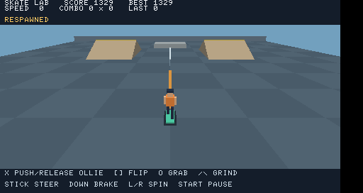

# Skate Lab for PSP

A small native PSP skateboarding prototype, created as a foundation for exploring
a Tony Hawk's Underground port. **This is an original demo, not a port of THUG.**
It contains no THUG engine, levels, characters, missions, music, or disc assets.

[Download the prebuilt PSP demo](https://github.com/CaptainHookJL/Tony-Hawk-Pro-Skater-PSP/raw/refs/heads/main/downloads/SkateLab-PSP.zip).
Open its `EBOOT.PBP` in PPSSPP, or copy its `PSP/GAME/SkateLab` folder to a PSP
configured to run homebrew. Controls and build instructions are below.



The PS2 game files are not the game's source code. A complete port would require
recovering or reconstructing the engine, understanding the asset formats, and
adapting rendering, memory use, controls, audio, scripting, and game systems to
the PSP. See [the porting roadmap](docs/PORTING.md) for that work.

## Prototype

- 3D test park, two launch ramps, a ledge, and a grind rail.
- Chase camera and a simple animated skater and board.
- Acceleration, braking, charged ollies, kickflips, grabs, spins, and rail grinds.
- Combo scoring on landing, lost combos on a bail, pause, and respawn.
- Fixed 120 Hz simulation; rendering waits for the PSP display's vertical blank.
- PSP GU rendering with no texture or external asset dependencies.
- Standard PSP user memory setting, including a PSP-1000 development target.

This is a deliberately small gameplay experiment. It has no manuals, reverts,
walking, objectives, saving, audio, or THUG-accurate physics. The ledge is a solid
obstacle; only the central rail supports grinding.

## Build in this cloud workspace

Use the existing checkout; each cloud task is already isolated and needs no Git
worktree. The installer pins PSPDEV `v20261001` for Linux x86_64 and verifies the
archive against the SHA-256 published on the official GitHub release page.

```bash
cd /workspace/Tony-Hawk-Pro-Skater-PSP
bash scripts/install-pspdev.sh
source scripts/env.sh
make test
make package -j4
```

Toolchain files live outside the checkout in `/workspace/.tools`. Other platforms
can install [PSPDEV](https://github.com/pspdev/pspdev/releases), set `PSPDEV`, and
put `$PSPDEV/bin` on `PATH` before running `make package`. `make test` requires
only a host C99 compiler and the standard math library, not the PSP SDK.

The game is written to `dist/PSP/GAME/SkateLab/EBOOT.PBP` and bundled with
instructions in `dist/SkateLab-PSP.zip`. Open the EBOOT file in
[PPSSPP](https://www.ppsspp.org/), or copy the `SkateLab` folder to
`PSP/GAME/` on a PSP configured to run homebrew. The ELF and PRX for debugging
are in `build/psp/`. `make clean` removes generated outputs.

## Controls

| PSP control | Action |
| --- | --- |
| Analog stick left/right, or D-pad left/right | Steer on the ground |
| Hold Cross (X) | Push and charge an ollie |
| Release Cross (X) | Ollie |
| D-pad down | Brake on the ground |
| Square | Kickflip while airborne; allow it to finish before landing |
| Hold Circle | Indy grab while airborne |
| Hold Triangle | Catch and remain on the central rail while descending |
| L / R | Spin left / right while airborne |
| Start | Pause / resume |
| Select | Respawn, preserving banked score |
| Home | Exit |

From spawn, hold X to skate toward the orange stripe. Release X near the start
of the central rail (several board lengths early), then hold Triangle as you
come down onto it. Steer toward
either bank for ramp launches. Complete flips and align spins to a multiple of
180 degrees before landing to bank the combo.

## Development and validation

`src/skate.c` implements portable movement and scoring. `src/render.c` renders
the park with PSP GU/GUM. `src/main.c` handles PSP input, timing, and exit callbacks.

`make test` exercises pushing, braking, ollies, successful and failed trick
landings, combo banking, score preservation, rail catch/release, ramp launches,
solid ledge collision, park bounds, and a deterministic five-minute session.
These host checks do not validate rendering, audio, device controls, or frame rate.

The PSP cross-build and host gameplay checks were completed in the cloud
workspace. A separate PSP smoke build also completed 300 frames in headless
PPSSPP, exercising a flip/grab/grind combo, pause/resume, and respawn. Its rendered
park was captured and visually inspected. Real PSP hardware play testing is
still required before making hardware compatibility or performance claims.

To repeat the PSP integration check in this prepared workspace:

```bash
source scripts/env.sh
make smoke
```

The screenshot and emulator log are written to `build/emulator/`. The smoke
target uses a separate build with scripted input; the packaged game retains
normal controller input. If the headless emulator needs to be recreated in this
Debian Linux x86_64 cloud machine, run `bash scripts/install-emulator.sh`. That
helper builds a pinned PPSSPP revision from its official repository and keeps
its dependencies outside this checkout. This can take several minutes on a
fresh machine. No GUI or background service is required.
